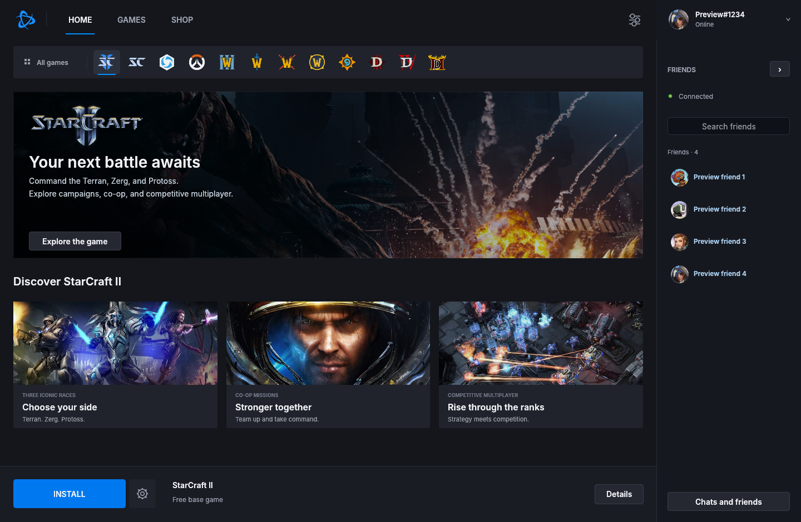
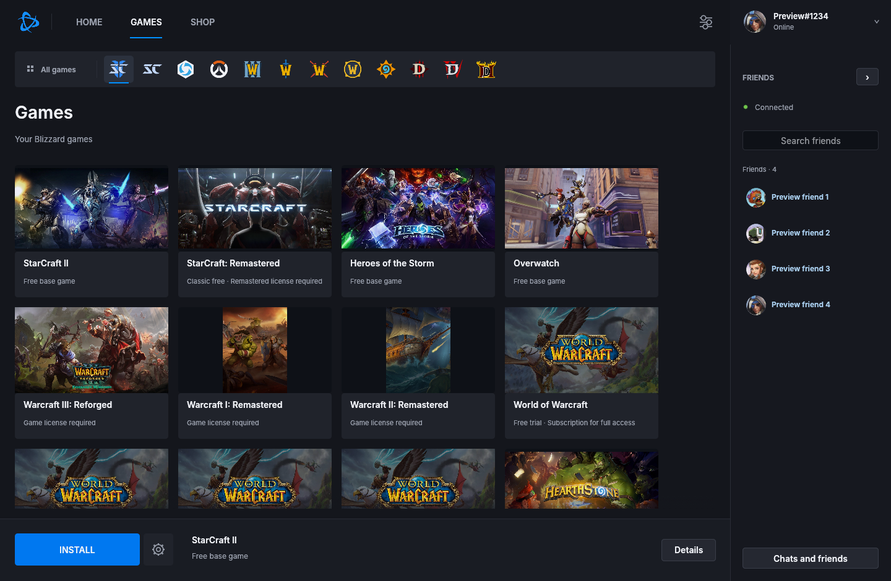
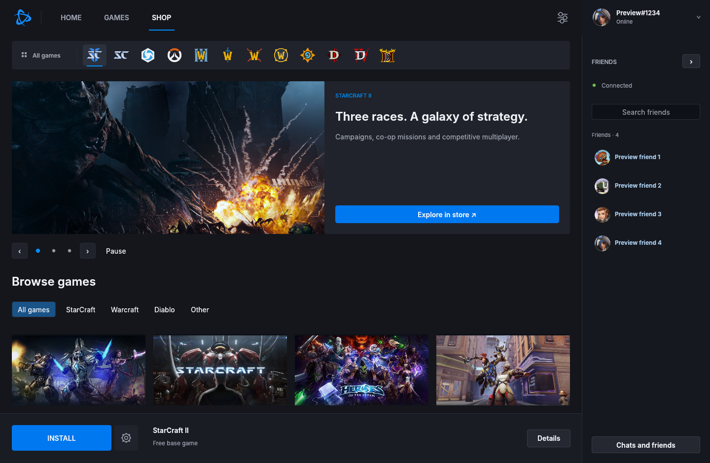
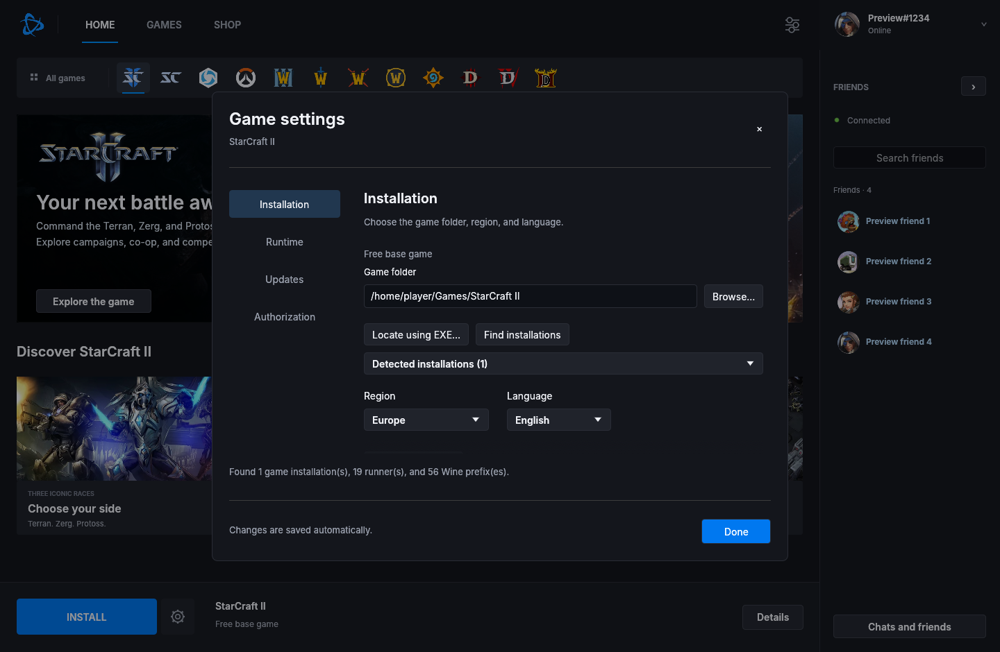

# Battle.net Linux

A native Rust launcher for Linux, with Blizzard sign-in, friends and chat, a game library, and native game downloads and updates. Windows games run through your host Wine or Proton/umu installation.

This is an independent, unofficial project. It is still in development; see the [release status](docs/release.md) for tested features and limitations.



## Features

- Blizzard-managed sign-in with remembered sessions and server-issued renewal credentials.
- Friends sidebar, account and friend avatars, centered contact search, and direct messages.
- Game discovery, folder/executable pickers, and Wine/Proton configuration.
- Native installation and patching from Blizzard's CDN, with background version checks, cancellation, and interrupted-update recovery.
- An in-app game catalogue with featured slides and links to Blizzard's store.
- Wayland and X11 support, a system tray, and a close-window choice between minimizing and quitting.
- A responsive layout for normal and ultrawide desktops.

### Game library



### Shop and game settings

| Shop | Game settings |
| --- | --- |
|  |  |

Screenshots use a preview account and sample contacts. Portraits and game artwork belong to Blizzard; see [asset sources](assets/SOURCES.md).

[View the ultrawide launcher preview](docs/screenshots/ultrawide.png).

## Install locally

Flatpak is the primary distribution package. It bundles the launcher, sign-in helper, fonts, and Windows authorization bridge. Game files and Wine/Proton stay on the host.

```sh
sh scripts/package-flatpak.sh
sh scripts/install-release.sh
flatpak run io.github.battlenet_linux.Launcher
```

The install script preserves existing settings and saved sessions. After updating, **Quit** the running launcher through the tray or account menu and reopen it: reopening an existing process activates that process rather than replacing it.

Building the package requires Rust, `org.freedesktop.Sdk//25.08`, `org.gnome.Platform//50`, GTK 3/WebKitGTK 4.1 development packages, and cached Cargo dependencies. See [packaging details](docs/release.md).

## Set up a game

1. Sign in through Blizzard's managed login window. Passwords and MFA are entered there.
2. Select a game and open **Game settings**. Locate the installation and select an existing Wine prefix or Proton/umu setup. Installation and runtime pickers are available.
3. Choose the region and language, then install, update, or press **Play**. Game-specific authorization may be needed when its protected ticket expires.
4. Use **Account menu → Refresh session** to reconnect with saved credentials, or **Game settings → Authorization → Refresh authorization** to replace the selected game ticket. Use the account menu to sign out or quit. Launcher settings and game settings are separate.

For StarCraft II, select its installation folder or `Support64/SC2Switcher_x64.exe`. The switcher performs setup required by current builds; invoking a versioned game executable directly can fail with exit code 47.

## What is verified

StarCraft II sign-in and online launch have worked locally with Windows Battle.net closed. Chat authorization, friend loading, and avatars have been confirmed locally. No private test messages were sent, so end-to-end message delivery remains unverified. Credential renewal is implemented; long-term expiry and revocation need broader testing.

Adapters also exist for StarCraft: Remastered, Heroes of the Storm, Overwatch, Warcraft I/II Remastered, Warcraft III, WoW editions, Hearthstone, and Diablo II/III/IV. These additional adapters have **not** been validated by downloading and launching each game. Compilation does not establish game or anti-cheat compatibility.

The shop is a curated catalogue, with purchases completed on Blizzard's site. Live pricing, balance, checkout, group chat, historical message synchronization, and account entitlement lookup are not implemented. Installing files does not grant a license or subscription. **BUY** and **SUBSCRIBE** describe the product requirement, not verified ownership: purchases do not automatically change these buttons yet. Existing owners can use **Install with existing access** in Game settings. Refresh session renews the connection; it does not query purchases.

The launcher adapts to ultrawide desktops. **An SC2 gameplay ultrawide patch is not implemented**; launcher layout changes do not remove the game's aspect-ratio limit.

## Development

```sh
sh scripts/run.sh
cargo test --locked --offline
cargo fmt --check
```

The run script builds both the launcher and its sign-in helper. Browse without signing in with `cargo run --locked -- --library`. Import local game/runtime preferences with `--profile launcher.local.json`; keep machine-specific configuration out of Git.

Additional documentation: [authentication](docs/authentication.md), [chat](docs/chat.md), [native updates](docs/updates.md), and [release status](docs/release.md).
